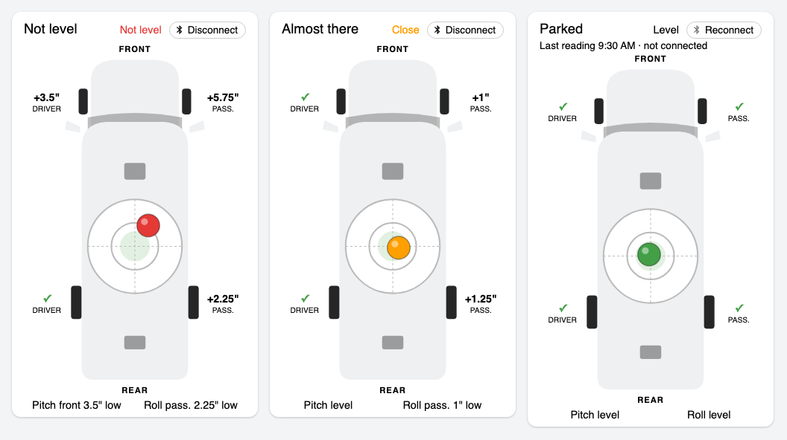

# RV Level Card

A Home Assistant Lovelace card that shows your RV from above, with a level ball
that rolls toward the low corner. It also shows how much to raise each corner,
plus pitch and roll.

Built for the LogicBlue **LevelMatePRO / LevelMatePRO+** through the
[Unofficial LevelMate Pro integration](https://github.com/timsys512/home-assistant-levelmate).
It works with any pair of sensors that report front/back and side-to-side tilt
in inches.

> **Huge thanks to [@timsys512](https://github.com/timsys512)** for
> [home-assistant-levelmate](https://github.com/timsys512/home-assistant-levelmate).
> They reverse-engineered the LevelMate's Bluetooth protocol and built the
> integration that connects it to Home Assistant. This card is only the
> display; their integration does the work. Install it first, and give the
> repo a ⭐.



## Features

- **Top-down Class C outline.** The ball rolls downhill toward the low corner.
  Set `mode: bubble` to make it float to the high side like a bubble level.
- **Color status:** green when level, amber when close, red when not level.
- **Corner readouts:** how many inches to raise each corner, with a ✓ when it's
  within tolerance.
- **Last reading.** When the leveler is off or disconnected, the card shows the
  last values from Home Assistant history, greyed out and timestamped. Every
  device sees the same values.
- **Connect / disconnect button.** **Disconnect** releases the Bluetooth link so
  the official LevelMate app can connect. **Reconnect** reloads the integration,
  which also recovers if the leveler was off when Home Assistant started.
- Follows your Home Assistant theme, light or dark.

## Installation

**Prerequisite:** install and set up
[timsys512/home-assistant-levelmate](https://github.com/timsys512/home-assistant-levelmate)
so your LevelMate's sensors are in Home Assistant.

### HACS (custom repository)

1. HACS → ⋮ → **Custom repositories** → add `https://github.com/jasontucker/rv-level-card`
   with type **Dashboard**.
2. Install **RV Level Card**, then reload your browser.

### Manual

1. Copy `rv-level-card.js` to `/config/www/rv-level-card.js`.
2. Settings → Dashboards → ⋮ → **Resources** → add `/local/rv-level-card.js`
   as a **JavaScript module**.
3. Reload your browser.

## Configuration

When you add the card from the card picker, it fills in the LevelMate Pro
entities automatically. To configure it by hand:

```yaml
type: custom:rv-level-card
title: Level
front_entity: sensor.levelmate_raw_front_reading
side_entity: sensor.levelmate_raw_side_reading
connection_entity: switch.levelmate_bluetooth_connection   # optional: shows the button
corners:                                                   # optional: corner readouts
  driver_front: sensor.levelmate_driver_front_corner
  passenger_front: sensor.levelmate_passenger_front_corner
  driver_back: sensor.levelmate_driver_back_corner
  passenger_back: sensor.levelmate_passenger_back_corner
```

| Option | Default | Description |
|---|---|---|
| `front_entity` | required | Front/back tilt in inches. Positive means the **front is low**. |
| `side_entity` | required | Side-to-side tilt in inches. Positive means the **passenger side is low**. |
| `connection_entity` | none | Switch that holds the Bluetooth connection. Enables Disconnect. |
| `corners` | none | Sensors for how much each corner needs raising. |
| `title` | `Level` | Card title. |
| `mode` | `ball` | `ball` rolls to the low side; `bubble` floats to the high side. |
| `max_inches` | `6` | Tilt that puts the ball at the edge of the ring. |
| `level_tolerance` | `0.5` | Inches counted as level (green). Amber goes up to 4× this. |
| `history_days` | `30` | How far back to look for the last reading. |

The sign convention matches the LevelMate Pro integration. If your sensors use
the opposite signs, add a template sensor that negates the value.

## Calibration tips

Set up and calibrate the leveler in the official LevelMate app first. Get the
coach truly level, set the mounting direction, then calibrate. The card shows
the values the device reports, so if the app isn't calibrated, the card won't
read zero on level ground.

## Credits

- **[timsys512](https://github.com/timsys512)** reverse-engineered the
  LevelMate Pro Bluetooth protocol from the official app and wrote
  [home-assistant-levelmate](https://github.com/timsys512/home-assistant-levelmate).
  The corner math, sign conventions and connection switch this card relies on
  all come from their work. Thank you!
- Not affiliated with LogicBlue Technology.

## License

MIT
